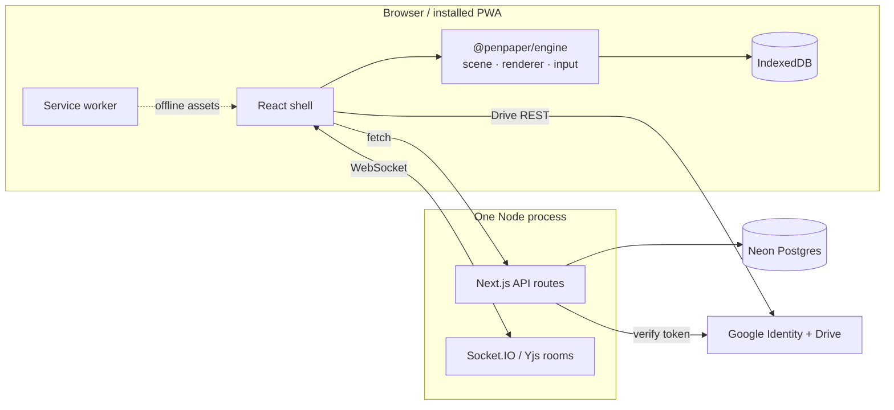
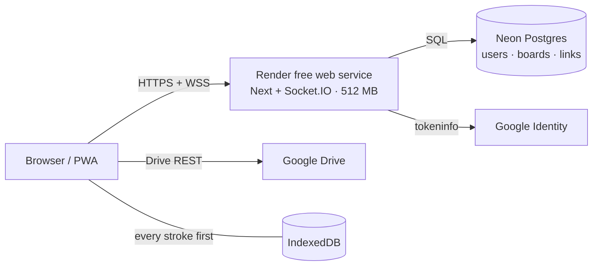

# PenPaper

An infinite whiteboard that keeps up with a pen, a finger, or a mouse. It is
local-first: every stroke is written to the device immediately, the board
reopens where you left it, and the installed app keeps working offline. Sign in
and your notepads follow you to every device; a share link puts other people on
the same canvas, live.


| Desktop | Phone |
| :---: | :---: |
|  |  |

**[penpaper-j09r.onrender.com](https://penpaper-j09r.onrender.com)** — the live
deployment. Sign in with any Google account; no test-user list. The whole stack
runs on free tiers, see [Hosting](#hosting).

## Features

**Canvas.** Infinite pan and zoom with a cached grid. Pressure-sensitive
freehand ink with palm rejection. Eight shapes — rectangle, ellipse, diamond,
triangle, hexagon, star, line, arrow — drawn in the Excalidraw visual language.
Text through a real textarea overlay with IME support. A laser pointer (`L`)
that never enters the scene, and an Excalidraw-style eraser with a fade-out.

**Editing.** Click, shift-click, and marquee selection; move, resize, and
rotate. Handles follow the shape rather than its bounding box, and a finished
pen stroke stays unselected. Transaction-based undo/redo, 100 steps deep, where
a 50-move drag is one step.

**Chrome.** Floating islands only: a dock, a history pill, and one hamburger
menu. Vertical dock on desktop, horizontal on phones, style rail from tablet
width. Every surface shares one Liquid Glass material and one 220 ms spring
motion. Light, dark, or system theme, three paper layouts, and PNG export.

**Library.** A launcher that reopens the last notepad, an in-menu notepad list
with rename and delete, and IndexedDB autosave every 500 ms. Installable PWA
with an offline app shell that survives the first visit.

**Accounts.** Google is the only way in — no passwords. One consent covers the
account and Drive, the server verifies the token with Google, and sessions are
32-byte tokens stored only as SHA-256 hashes.

**Drive sync (optional).** One JSON document per notepad in a visible `PenPaper`
folder, written straight from the browser with an hour-long token. Pull, merge,
save, then upload; newer `updatedAt` wins and deletions travel as tombstones.

**Live collaboration.** Share links with owner, editor, or viewer roles, enforced
on REST and on the socket. Yjs over Socket.IO at stroke speed, peer cursors with
name and colour, and a live roster where the host can remove a participant.
Viewers open read-only: hand tool only, and the server refuses writes anyway.

## Architecture

`apps/web` is a thin React shell. `packages/engine` owns the scene, camera,
spatial index, renderer, input state machine, selection, and history. No element
data is copied into React state, so a board with thousands of shapes does not
produce thousands of renders while drawing.



A board lives in three places: IndexedDB on every device, Postgres for the
account, and an in-memory room while people are present. Each is merged
element-by-element, so two people drawing different shapes never conflict.
Details in [`docs/ARCHITECTURE.md`](docs/ARCHITECTURE.md).

## Tech stack

| Layer | Choice |
| --- | --- |
| App shell | Next.js 16.4 (App Router), React 19.3, TypeScript 7 |
| Canvas | `@penpaper/engine`, framework-agnostic TypeScript |
| Sketch geometry | Rough.js 4.6 |
| Pen strokes | Perfect Freehand 1.2 |
| State and storage | Zustand 5, IndexedDB via `idb` 8 |
| Accounts and boards | Postgres on Neon's free tier |
| Live rooms | Socket.IO 4.8 + Yjs 13.6 in the same Node process |
| Tests | Vitest 5, Playwright 1.64 |
| Host | Render free web service |

## Quick start

Requires Node 22+ and pnpm 12.

```bash
pnpm install
pnpm --filter web dev        # http://localhost:3000
```

Use `localhost`, not `127.0.0.1` — Next treats them as different origins.
`/` opens the last notepad, `/b/demo` the seeded demo, `/s/<token>` a share link.

Without configuration the app is a local-first whiteboard. Accounts, sharing,
and rooms switch on when these are set in `apps/web/.env.local` (see
[`apps/web/.env.example`](apps/web/.env.example)):

| Variable | Purpose |
| --- | --- |
| `DATABASE_URL` | Postgres connection string (`sslmode=require`) |
| `PENPAPER_SECRET` | 32+ random bytes, signs the five-minute room token |
| `NEXT_PUBLIC_GOOGLE_CLIENT_ID` | Public OAuth client for sign-in and Drive |

The schema creates itself on first request, and the build never needs the
database. Google setup is one Web application client with the site origin under
**Authorized JavaScript origins** — see [`docs/GOOGLE-DRIVE.md`](docs/GOOGLE-DRIVE.md).

## Scripts

| Command | Purpose |
| --- | --- |
| `pnpm --filter web dev` | Next + Socket.IO in one process |
| `pnpm --filter web build` | Production build |
| `pnpm --filter web start` | Production server with live rooms |
| `pnpm -r typecheck` | TypeScript across all packages |
| `pnpm -r test` | Engine and web unit tests |
| `pnpm --filter web e2e` | Playwright browser tests |
| `pnpm --filter web check:bundle` | Board-route gzip budget |

## Testing

| Metric | Result | Gate |
| --- | --- | --- |
| Engine unit tests | 218 passing | all green |
| Web unit tests | 70 passing | all green |
| Browser tests | 45 passing | all green |
| Renderer body, 1,000 shapes | 8.4 ms median | ≤ 16 ms |
| Board route, gzip | 193.7 KiB | ≤ 220 kB |

The frame number is measured on the renderer's own body, not on
`requestAnimationFrame` deltas.

## Hosting

Live at **<https://penpaper-j09r.onrender.com>**. One Render web service serves
the React app, the API routes, and the Socket.IO rooms from a single Node
process, so collaboration costs no second instance. Postgres is Neon's free
tier. No object storage, no expiring trial, no card.



**Deploy a copy**

1. Create a free Postgres project at [neon.tech](https://neon.tech) and copy the
   pooled connection string, keeping `sslmode=require` and dropping
   `channel_binding`.
2. In Render, choose **New → Blueprint** and select this repository.
   [`render.yaml`](render.yaml) sets the free plan, Singapore, the build, and
   `node server/main.mjs --prod` as the start command.
3. Set `DATABASE_URL`, `PENPAPER_SECRET`, and `NEXT_PUBLIC_GOOGLE_CLIENT_ID`.
   `NEXT_PUBLIC_*` is inlined at build time, so redeploy after changing one.

**Publishing Google sign-in**

The OAuth client is one **Web application** client with the site origin under
**Authorized JavaScript origins** — there is no client secret and no redirect
URI, because the browser receives a token and the server verifies it.

While the consent screen is in *Testing*, only added test users can sign in.
Leaving Testing needs three things, all free:

- **Data access** limited to `openid`, `userinfo.email`, `userinfo.profile`, and
  `drive.file` — all non-sensitive, so no Google review.
- A **home page** and **privacy policy** URL on an authorized domain. Both point
  at the deployment itself, the policy at [`/privacy`](https://penpaper-j09r.onrender.com/privacy).
- **Ownership verification** of that domain in [Search Console](https://search.google.com/search-console)
  with the HTML file in `apps/web/public/`. Brand verification checks this, and
  it can take a day to propagate.

`onrender.com` is on the Public Suffix List, so the authorized domain is the full
app host, not `onrender.com`.

The free instance sleeps after 15 minutes. The board paints from IndexedDB
before any network call, so a cold start is never data loss, and
[`warm.yml`](.github/workflows/warm.yml) keeps it awake 07:30–00:29 IST through
the `PENPAPER_URL` repository variable.

## Roadmap

Image upload and arrow binding are the remaining phases; the element model
already carries the fields and tombstone semantics they need.

## Team

[Rishabh Singh](https://github.com/RishabhDotIn) ·
[Vaibhav Sharma](https://github.com/Vaibhav-006)

## License

Private project; no license granted.
