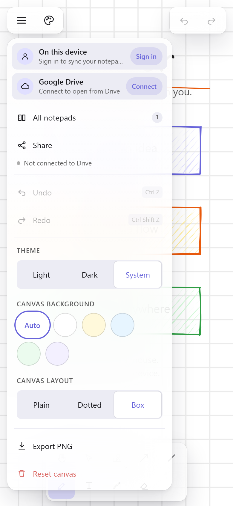
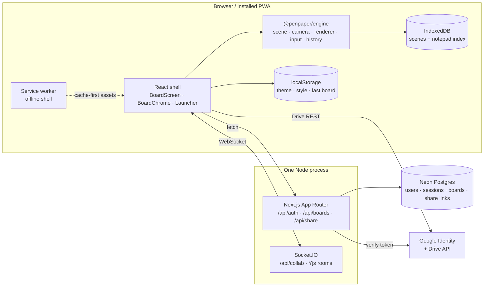
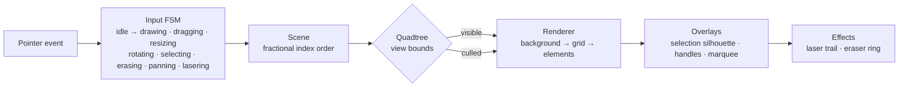
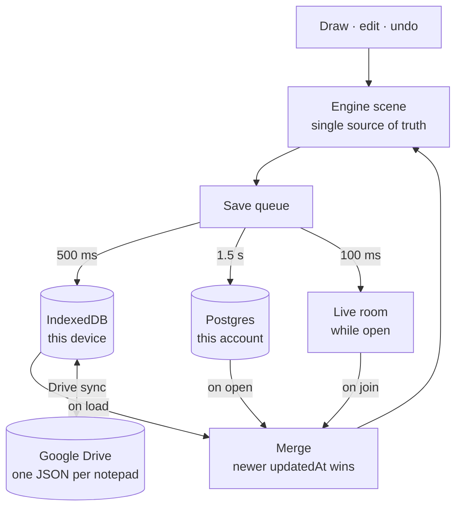
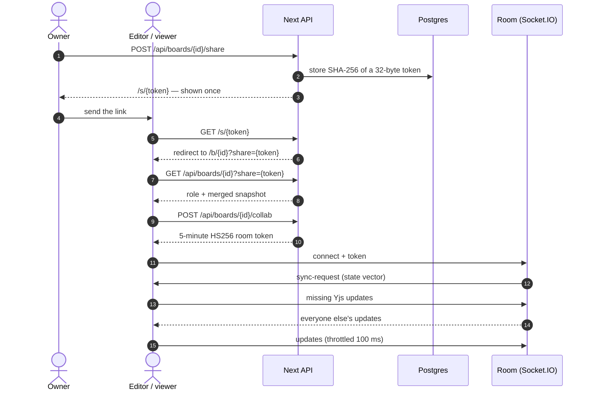
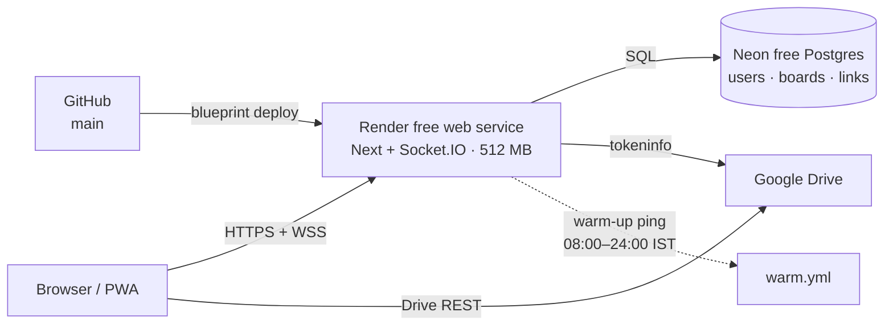

<div align="center">

# PenPaper

**An infinite whiteboard that keeps up with a pen, a finger, or a mouse.**

Local-first by default · Google sign-in when you want it · live rooms when you need them


[Features](#features) · [Architecture](#architecture) · [Keyboard shortcuts](#keyboard-shortcuts) · [Quick start](#quick-start) · [Deploying](#deploying)

</div>


PenPaper is a whiteboard you can open and start drawing in immediately. Every
stroke goes to the device first, so the page never waits on a server, the board
reopens exactly where you left it, and the installed app still works without a
network. Sign in and the same notepads follow you to every device; send a link
and other people join the same canvas, live.

**Live demo:** not deployed yet — the whole stack fits on free tiers, see [Deploying](#deploying).

---

## Contents

- [Screenshots](#screenshots)
- [Features](#features)
- [Keyboard shortcuts](#keyboard-shortcuts)
- [Architecture](#architecture)
- [Tech stack](#tech-stack)
- [Quick start](#quick-start)
- [Configuration](#configuration)
- [Scripts](#scripts)
- [Project layout](#project-layout)
- [Testing and performance](#testing-and-performance)
- [Deploying](#deploying)
- [Roadmap](#roadmap)
- [Team](#team)

---

## Screenshots

| Desktop | Phone |
| :---: | :---: |
|  |  |

| Launcher — first open, recent notepads | Board menu — account, Drive, notepad list, live room |
| :---: | :---: |
|  |  |

<p align="center">
  
  <br />
  <sub>The same menu on a phone, as a Liquid Glass card.</sub>
</p>

---

## Features

### Canvas and drawing

- **Infinite canvas** — scroll or two-finger drag to pan, pinch or `Ctrl`+wheel to zoom, with a cached grid that stays crisp at any scale.
- **Freehand ink** — pressure-sensitive strokes via Perfect Freehand, coalesced pointer samples, and a palm-rejection heuristic so a resting hand does not leave marks.
- **Sketchy shapes** — rectangle, ellipse, diamond, triangle, hexagon, star, line, and arrow, drawn in the Excalidraw visual language (hachure, cross-hatch, or solid) with Rough.js as a geometry generator, never a per-frame renderer.
- **One palette, not seven dock slots** — the six filled shapes share a single button that opens a two-column pocket palette; adding another polygon costs a vertex table entry, not screen space.
- **Text** — a real browser textarea overlay with IME composition, wrapped layout, `16px` minimum size (no iOS focus zoom), and `visualViewport` lifting so the Android keyboard never covers the caret.
- **Laser pointer** (`L`) — a GoodNotes-style fading trail for pointing. It is light, not ink: never in the scene, history, saved board, or export.
- **Eraser** — an Excalidraw-style ring that follows the pointer, leaves a soft trail while pressed, and shrinks the element away over 220 ms. One press is one undo step; the animation is never saved.

### Editing

- **Selection and transforms** — click, shift-click, marquee, move, resize, rotate, including already-rotated elements.
- **Shape-aware handles** — a rectangle keeps the eight-handle grid, a diamond and an ellipse get four cardinal dots, a triangle, hexagon, and star put one handle on every outer corner (a star only its five tips). The selection outline traces the same silhouette.
- **Right-click adjusts, never draws** — grabbing a handle while a shape tool is still armed means "make it bigger", not "draw another one".
- **Transactional history** — a 50-move drag is one undo step, an empty gesture adds nothing, and redo restores geometry without replaying thousands of commands. 100 commands deep.
- **PNG export** of the current view, with every gesture effect stripped out.

### Chrome and theming

- **Canvas-first chrome** — floating islands only: a dock, a history island, and a hamburger menu. No title bar, no permanent colour bar, no wordmark.
- **Responsive by measurement** — vertical dock on desktop, horizontal two-row dock on phones, right-side style rail from tablet width, anchored style card below it.
- **Liquid Glass, one material** — translucent tint, saturating blur, specular sheen, hairline rim, and depth shadow shared by every surface, with a solid fallback under `prefers-reduced-transparency`.
- **One motion language** — a 220 ms spring arrival that grows from the control that opened it, a 160 ms exit, and real exit animations instead of nodes vanishing between frames.
- **Light, dark, or system** — resolved before first paint, so a dark board never flashes white. Default ink is mapped at paint time, so stored near-black strokes stay readable in dark mode without rewriting user colours.
- **Paper, not just pixels** — plain, dotted, or boxed paper, plus background presets, all remembered per device.
- **44 px targets everywhere** on coarse pointers, with a 22 px touch hit radius instead of 8 px for a mouse.

### Notepads, persistence, and offline

- **Reopen where you left off** — `/` returns to the last notepad; a device that has never opened one gets a single card with recent notepads and a blank page.
- **IndexedDB autosave** — 500 ms debounce, a flush on `pagehide` and tab hide, camera restoration on reload, and a graceful downgrade to in-memory if storage fails.
- **Notepad list in the menu** — open, inline rename, two-tap delete, and new notepad without leaving the canvas. No separate management page.
- **Installable PWA** — offline app shell, manifest, maskable icons, and a service worker that caches the rendered board on first visit, so the *first* offline open works.
- **Self-updating tabs** — a new deploy is picked up when the page becomes visible, and the swap lands when the tab is hidden, never mid-stroke.

### Accounts

- **Google is the only way in** — there is no password anywhere in the system.
- **One consent, two jobs** — a single popup asks for `openid email profile` and `drive.file`, so signing in connects Google Drive at the same time. A returning tab renews silently with `prompt=none`.
- **Server-side verification** — `/api/auth/google` checks the token with Google's `tokeninfo` endpoint: audience, subject, verified email. No client secret, no code exchange, no JWT keys to cache.
- **Hashed sessions** — 32 random bytes stored only as SHA-256, in an `httpOnly`, `SameSite=Lax`, `Secure`-in-production cookie with a 30-day expiry. A stolen database row is not a usable cookie.
- **One shelf** — the notepads you own are listed newest first, from any device, merged element by element with the copies on the device and in Drive.

### Google Drive sync (optional)

- **A second copy, never the source of truth** — the board loads from IndexedDB first; Drive reconciliation happens after first paint and does nothing when no account is connected.
- **No Drive backend** — the browser talks to Drive directly with an hour-long token kept in `sessionStorage`. No client secret, no refresh token, no Drive traffic through PenPaper's server.
- **Visible and portable** — one JSON document per notepad, `<title>.penpaper.json`, in a `PenPaper` folder, tagged with app-private properties so renaming the folder does not strand it.
- **Pull, merge, save, upload** — never the other way round. Elements merge by id with newer `updatedAt` winning; deletions travel as tombstones and cannot be resurrected by an offline device.
- **Per-notepad control** — auto-sync for the whole library, or manual Sync / Remove from Drive per row.

### Live collaboration

- **Share links with three roles** — **owner** (the account only), **editor**, **viewer**. One active link per role; minting another replaces it, which is how revoke works.
- **Stroke-speed editing** — Yjs over Socket.IO, throttled to one push per 100 ms during a stroke, so peers watch a shape grow instead of waiting for pointer-up.
- **Cursors with identity** — each peer's pointer carries a name and a colour, positioned from the camera every animation frame, so panning moves pointers without re-rendering the chrome.
- **Live roster** — a Live pill lists everyone in the room; the host can remove a participant, and that identity is refused when it tries to rejoin.
- **Read-only is a mode, not a disabled button** — a viewer opens with the hand tool, no toolbar, no history, no style panel, and no text overlay. The server still refuses writes on REST and on the socket, so a patched client cannot draw.
- **Rooms are disposable** — seeded from the first client's full document, 30 s grace after the last peer leaves, 32 peers and 500 rooms per process, idle rooms dropped.
- **Durable sync is separate** — a 1.5 s debounced whole-snapshot `PUT` to Postgres is the source of truth across devices; the room is a fast cache that disappears when it empties.

### At a glance

| Capability | Without an account | Signed in | With a share link |
| --- | :---: | :---: | :---: |
| Draw, edit, undo | ✅ | ✅ | editor only |
| Local autosave and reload | ✅ | ✅ | ✅ |
| Install / offline | ✅ | ✅ | ✅ |
| Notepads follow you | — | ✅ | — |
| Google Drive copy | ✅ (Drive only) | ✅ (same consent) | — |
| Live room | — | ✅ host | ✅ editor / viewer |

---

## Keyboard shortcuts

| Key | Action | Key | Action |
| --- | --- | --- | --- |
| `V` / `1` | Selection | `L` | Laser pointer |
| `H` | Hand (pan) | `9` | Eraser |
| `R` / `2` | Rectangle | `Delete` / `Backspace` | Delete selection |
| `O` / `4` | Ellipse | `Ctrl/⌘ Z` | Undo |
| `D` / `3` | Diamond | `Ctrl/⌘ Shift Z` | Redo |
| `T` | Triangle | `Ctrl/⌘ Y` | Redo (Windows) |
| `G` | Hexagon | `Escape` | Clear selection / close popover |
| `S` | Star | `5` / `6` | Arrow / Line |
| `7` | Draw | `8` | Text |

Shortcuts return early while typing in the text overlay, and a viewer gets no
tool shortcuts at all.

---

## Architecture

One principle runs through the whole app: **the canvas is local, the network is
optional, and nothing blocks the first frame.**



`apps/web` is a thin React shell. `packages/engine` owns the scene, camera,
spatial index, renderer, input state machine, selection, and history. **No
element data is copied into React state**, so a board with thousands of shapes
does not produce thousands of renders while drawing.

### One frame



`render()` returns immediately when nothing is dirty; an idle board does no
work. Rough.js generates geometry once per type, size, seed, and style, and the
drawable cache holds 4,096 entries — dragging a shape never regenerates its
wobble.

### Where a board lives



Every merge is element-level: two people drawing different shapes never
conflict, and a delete is a tombstone, so an offline device cannot bring back
what someone else erased.

### Joining a live room



The room process never touches Postgres. Routes mint a five-minute JWT carrying
board, user, role, name, and colour; the socket verifies signature and expiry
and trusts nothing else from the client. Authorization therefore lives in one
place, while the hot path stays a signature check.

Deeper notes — the transactional history model, paint-time ink mapping, service
worker strategy, and the deployment decision log — are in
[`docs/ARCHITECTURE.md`](docs/ARCHITECTURE.md).

---

## Tech stack

| Layer | Choice | Why |
| --- | --- | --- |
| App shell | Next.js 16.4 (App Router), React 19.3, TypeScript 7 | One deployable, one Node process |
| Canvas | `@penpaper/engine` — framework-agnostic TypeScript | Testable under Node, no React in the hot path |
| Sketch geometry | Rough.js 4.6 | Excalidraw look, cached drawables |
| Pen strokes | Perfect Freehand 1.2 | Pressure-aware, fast |
| Chrome | `@penpaper/ui` — plain CSS with measured tokens | No UI framework between pointer and paint |
| Metadata state | Zustand 5 | Small, outside the render path |
| Device persistence | IndexedDB via `idb` 8 | Large scenes without a size cliff |
| Accounts and boards | Postgres on Neon's free tier (`postgres` driver) | Real rows, ₹0, no card |
| Live rooms | Socket.IO 4.8 + Yjs 13.6, same Node process | No second service, no extra instance hours |
| Sessions | Google `tokeninfo` + 32-byte random sessions (SHA-256) + HS256 room JWT | No passwords, no client secret |
| Tests | Vitest 5 (unit), Playwright 1.64 (browser) | Real browser seams, real storage |
| Host | Render free web service | WebSockets, 750 instance-hours, no card |

---

## Quick start

**Requirements:** Node 22+, pnpm 12.

```bash
pnpm install
pnpm --filter web dev        # http://localhost:3000
```

Use `localhost`, not `127.0.0.1` — Next's dev cross-origin rules treat them as
different origins and hydration silently stops.

`/` opens the last notepad on this device, or the chooser on a fresh one.
`/b/demo` opens the seeded demo board, `/b/<id>` a specific notepad, and
`/s/<token>` a share link.

With no environment set the app is the offline notepad it has always been.
Accounts, sharing, and rooms switch on when the variables below are present.

---

## Configuration

Copy [`apps/web/.env.example`](apps/web/.env.example) to `apps/web/.env.local`.

| Variable | Required for | Purpose |
| --- | --- | --- |
| `DATABASE_URL` | accounts, sharing, rooms | Postgres (Neon free tier). Use `sslmode=require`; `channel_binding=require` is rejected by the driver. |
| `PENPAPER_SECRET` | rooms | 32+ random bytes. Signs the five-minute room token. |
| `NEXT_PUBLIC_GOOGLE_CLIENT_ID` | sign-in and Drive | Public OAuth client. No client secret. |

```bash
node -e "console.log(require('crypto').randomBytes(32).toString('hex'))"
```

Use that for `PENPAPER_SECRET` — not a remembered phrase.

**Google setup:** create one **Web application** OAuth client, add
`http://localhost:3000` and the deployed origin under **Authorized JavaScript
origins**. There is no client secret and no redirect URI: the browser gets a
token and the server verifies it, so the origin allowlist is the whole
configuration. Step-by-step in [`docs/GOOGLE-DRIVE.md`](docs/GOOGLE-DRIVE.md).

The database schema creates itself on first request — no migration step, and
the build never needs the database.

---

## Scripts

| Command | What it does |
| --- | --- |
| `pnpm --filter web dev` | Next + Socket.IO in one process, with HMR |
| `pnpm --filter web build` | Production build |
| `pnpm --filter web start` | Production Node server + live rooms on `:3000` |
| `pnpm -r typecheck` | TypeScript across every package |
| `pnpm -r test` | Engine and web unit tests |
| `pnpm --filter web e2e` | Playwright against the dev server |
| `pnpm --filter web check:bundle` | Board-route gzip budget |
| `pnpm --filter web check:db` | Neon connectivity and schema status |

Production browser tests, including the offline PWA pass:

```bash
$env:E2E_PRODUCTION="1"; pnpm --filter web e2e    # PowerShell
E2E_PRODUCTION=1 pnpm --filter web e2e            # macOS / Linux
```

The offline test is skipped in development because Turbopack rehashes its HMR
client between server starts; a production bundle is the honest target.

---

## Project layout

```
apps/web                  Next.js App Router shell
  app/                    launcher, /b/[id], /s/[token], /api/*
  server/                 one Node process: Next + Socket.IO (main.mjs, collab.mjs)
  components/             Launcher, BoardLoader, BoardScreen, BoardChrome,
                          BoardSurface, LivePanel, PeerCursors, ShareDialog,
                          AccountPanel, TextEditorOverlay
  lib/storage.ts          IndexedDB scene + notepad index
  lib/library.ts          notepad list, demo seed, relative times
  lib/collab/             account, API client, durable sync, Yjs session
  lib/server/             schema, auth, roles, share tokens, room JWT
  lib/drive/              optional Drive: auth, REST, merge, reconcile
  public/sw.js            offline shell service worker
packages/shared           element model, defaults, fractional index
packages/engine           canvas engine, no React and no module-scope window
  scene/ math/ render/ input/ history/ selection/ text/
packages/ui               toolbar, properties panel, app menu, style popover, tokens
docs/                     architecture, Drive setup, specs, screenshots
```

---

## Testing and performance

Measured on an Asus TUF F15 (Windows 11, Chromium, 1440 × 900):

| Metric | Result | Gate |
| --- | --- | --- |
| Engine unit tests | 218 passing | all green |
| Web unit tests | 70 passing | all green |
| Browser tests | 45 passing | all green |
| Median renderer body, 1,000 mixed shapes | 8.4 ms (11.4 ms under a full parallel run) | ≤ 16 ms |
| Board route transfer, gzip | 193.7 KiB JS + CSS | ≤ 220 kB |

The frame number is the renderer's own body (cull, layout, paint commands), not
`requestAnimationFrame` deltas, which are clamped to the display refresh rate.
The bundle gate parses Turbopack's manifests and excludes `nomodule` polyfills
that modern browsers never download.

What the suites actually cover: scene semantics, fractional indices, camera
math, quadtree, hit testing, transforms, history, serialization, text layout,
rendering primitives and the rough cache; IndexedDB persistence, the notepad
index, preferences, Drive naming and merge, the reconciler against a mocked
Drive with real IndexedDB; and in Playwright, the launcher, menu, responsive
chrome, drag-as-one-undo, style-before-draw, theme and paper verified in canvas
pixels, autosave across reload, camera restoration, the frame budget, the
manifest, and the offline shell.

---

## Deploying

The app is a standard Node server (`next build` + `next start`); no
Vercel-specific APIs. Socket.IO upgrades share the same HTTP server, so live
rooms need no second service and no extra instance-hours.



1. Push the repository to GitHub.
2. Create a free Postgres project at [neon.tech](https://neon.tech) and copy the pooled connection string.
3. In Render, choose **New → Blueprint** and select the repo. [`render.yaml`](render.yaml) creates the free web service with the right build and start commands.
4. Set `DATABASE_URL` and `PENPAPER_SECRET` in the dashboard; add `NEXT_PUBLIC_GOOGLE_CLIENT_ID` and list the Render origin under **Authorized JavaScript origins**.
5. Open `/` on each device, sign in once, and the library follows.

`NEXT_PUBLIC_*` values are inlined at build time, so redeploy after changing
one. With none of the variables set, the deployment still builds and runs as a
local-first whiteboard; `/api/auth/me` reports `configured: false`.

### Why ₹0 stays ₹0

Render free (512 MB, 0.1 CPU, WebSockets, 750 instance-hours), Neon free
Postgres, no object storage, no expiring trial. Rooms run inside the one web
process, so collaboration does not buy a second instance. Image upload was
deferred rather than adding a storage bill.

The free instance sleeps after 15 minutes and takes ~60 s to wake. The board
renders from IndexedDB before any network work, so a sleeping server is a cold
start, not data loss. [`warm.yml`](.github/workflows/warm.yml) keeps it awake
08:00–24:00 IST at roughly 500 of the 750 free hours; set the repository
variable `PENPAPER_URL` to enable it.

---

## Roadmap

| Phase | Status |
| --- | --- |
| Infinite canvas, shapes, text, selection, history | ✅ Shipped |
| Local persistence, launcher, notepad list | ✅ Shipped |
| Installable PWA and offline shell | ✅ Shipped |
| Liquid Glass chrome and shared motion | ✅ Shipped |
| Google Drive sync | ✅ Shipped |
| Google accounts and share links | ✅ Shipped |
| Live rooms, rosters, and host removal | ✅ Shipped |
| Image upload | Planned — deferred to avoid a storage bill |
| Arrow binding to shapes | Planned — element model already supports it |

Design and phase notes live in
[`docs/superpowers/specs/2026-10-31-penpaper-design.md`](docs/superpowers/specs/2026-10-31-penpaper-design.md).

---

## Team

| | |
| --- | --- |
| **Rishabh Singh** | [@RishabhDotIn](https://github.com/RishabhDotIn) |
| **Vaibhav Sharma** | [@Vaibhav-006](https://github.com/Vaibhav-006) |

---

## License

Private project; no license granted.
