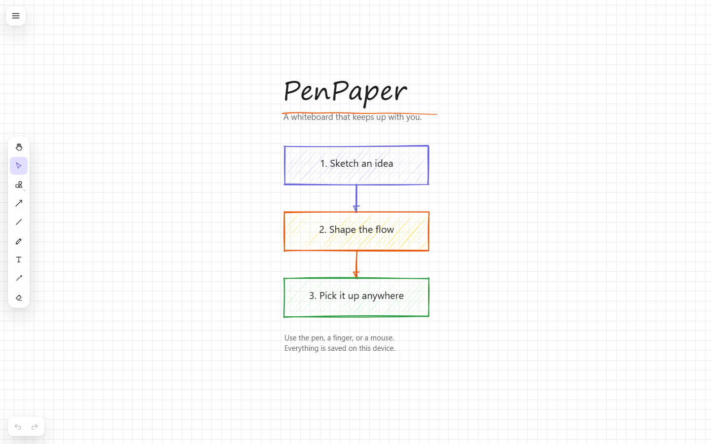
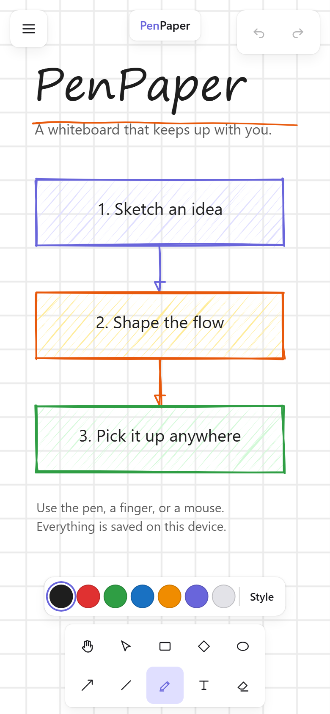
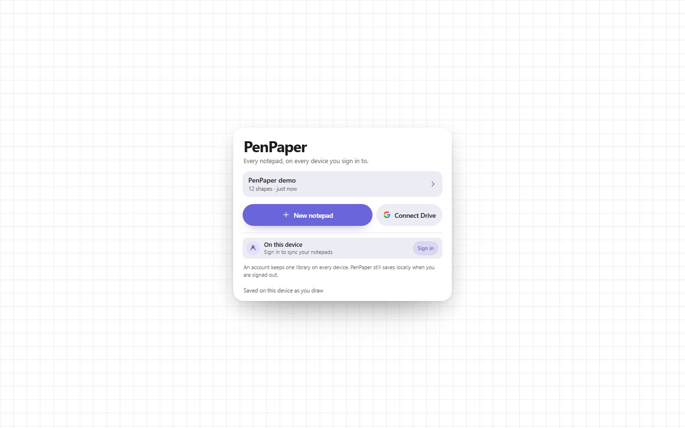
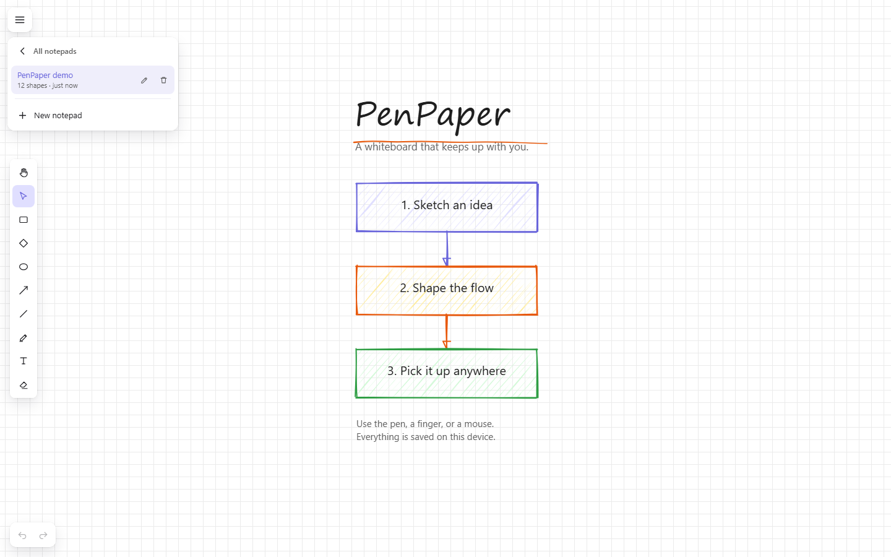

# PenPaper

An infinite whiteboard that keeps up with a pen, a finger, or a mouse. It is
local-first: every stroke is written to the device immediately, the board
reopens exactly where you left it, and the installed app keeps working when the
network does not. Sign in and the same notepads follow you to every device; a
share link puts other people on the same canvas, live.

**Live demo:** _deployment pending — see [Deploying](#deploying)._

| Desktop | Phone |
| --- | --- |
|  |  |

Opening `/` returns to the notepad you were last in. A device that has not
opened one yet gets a single card on paper: recent notepads, a blank page, and —
once you sign in or connect Drive — everything your account holds. The hamburger
carries the account and the full notepad list, where a notepad can be opened,
renamed, deleted, or synced without leaving the canvas.





## What works today

- **Infinite canvas** with scroll-to-pan, pinch-to-zoom, and a cached grid.
- **Freehand drawing** with pressure-sensitive strokes (Perfect Freehand), palm
  rejection, and coalesced pointer samples.
- **Shapes behind one dock button** — rectangle, ellipse, diamond, triangle,
  hexagon, and star share a single geometry button that opens a pocket palette,
  so adding shapes never pushes the pen off a phone screen; line and arrow stay
  one tap away. Drawn with Rough.js in the Excalidraw visual language (hachure,
  cross-hatch, solid).
- **Text** with a real browser textarea overlay, IME composition, wrapped
  layout, and no iOS focus zoom.
- **Selection and transforms** — click, shift-click, marquee, move, resize, and
  rotate, including on rotated elements. Handles follow the shape instead of
  boxing it: a diamond and an ellipse get four cardinal dots, a triangle,
  hexagon, and star put one on every outer corner (a star only its five tips),
  and box-shaped things keep the eight-handle grid. The selection outline traces
  that same silhouette rather than an empty corner. A finished pen stroke stays
  unselected, so fresh writing never grows resize handles and the style panel
  keeps pointing at the next stroke. Handles also work while a shape tool is
  still armed, and a right-click adjusts instead of drawing, so tweaking the
  shape you just made never costs a trip to the selection tool.
- **Laser pointer** (`L`) — a GoodNotes-style fading trail for pointing at the
  board. It is light, not ink: it never enters the scene, the undo history,
  a saved board, or a PNG export.
- **Eraser** — an Excalidraw-style ring that follows the pointer. Pressing leaves
  a soft trail and the element shrinks away instead of vanishing between frames;
  hover shows only the ring. Erasing is immediate and one undo step, and the
  animation is never saved or exported.
- **A style box that works before you draw.** Pick the pen, a shape, or the text
  tool and the panel edits the *next* element: stroke and background colour,
  fill, stroke width, dash, roughness, opacity, font, and arrowheads. Pick
  something on the canvas and the same panel edits that selection. The choice
  is remembered per device.
- **Hamburger menu** for the board itself: undo/redo, theme (light, dark, or
  system), canvas background presets, canvas layout (plain, dotted, or boxed
  paper), PNG export of the current view, and a two-tap reset that is undoable.
- **Eraser**, delete, and a transaction-based undo/redo history.
- **Local persistence** through IndexedDB: 500 ms debounced autosave, a flush on
  `pagehide`, and camera restoration on reload. Theme, paper, layout, and style
  defaults persist separately in `localStorage`.
- **Responsive chrome** measured against excalidraw.com: a vertical dock on
  desktop, a two-row dock on phones, a collapsible right-side style panel from
  tablet width up, and a style popover anchored to the palette button on
  smaller screens. The bottom edge holds the dock alone - there is no permanent
  colour bar, and no title bar or wordmark. Every coarse-pointer target is at
  least 44 px. Every floating surface — dock, menu, shape palette, style card,
  history island — shares one Liquid Glass material and one motion language:
  a 220 ms spring arrival that grows from the control that opened it, and a
  160 ms exit, so nothing pops in or vanishes between frames.
- **Installable PWA** with offline app shell, manifest, maskable icons, and a
  service worker that serves the board offline after the first visit.
- **A seeded demo board** at `/b/demo` — title, hand-drawn underline, three
  filled flow boxes, arrows, and notes — so the first open is not a blank page.

- **A notepad list in the menu** with a seeded demo, inline rename, two-tap
  delete, one-tap switching, and a new-notepad action. `/` reopens the last
  notepad and only asks once, on paper; there is no separate management page.
- **Optional Google Drive sync.** Connect one Google account and the same
  notepads appear on every device, stored as JSON files in a visible `PenPaper`
  folder. Auto-sync can be switched to per-notepad control, which adds a Sync /
  Remove from Drive action to each row. The browser talks to Drive directly with
  an hour-long token: no Drive backend, no client secret, no refresh token. Setup
  is one public client ID — see [`docs/GOOGLE-DRIVE.md`](docs/GOOGLE-DRIVE.md).
  Without it, the app stays local-only.
- **One Google account, one library.** Sign in with Google and the notepads you
  own are listed from anywhere, newest first, alongside the copies on the device
  and in Drive. There is no password to invent, reset, or leak: the browser gets
  a signed ID token from Google Identity Services and the server checks it
  against Google's published keys, so no client secret is involved either. One
  account's notepads are one shelf; opening a notepad on a second device pulls
  it, merges it element by element, and keeps the workspace you already have
  offline.
- **Live collaboration through a share link.** Mint a link from the menu with
  one of three roles: **owner** (only the account), **editor**, or **viewer**.
  An editor draws alongside you at stroke speed with their name and colour on
  their pointer; a viewer opens read-only — hand tool, no toolbar, no history,
  no rename, no delete — and cannot write even if the client is tampered with.
  Both roles are enforced on the REST routes and on the socket. Links are live
  until replaced or revoked, are returned once and stored only as a SHA-256
  hash, and a room seeds itself from the first client's full document, so a
  reload, a tunnel, or a closed laptop costs nothing. Edits are whole elements
  merged by `updatedAt`, so two people drawing different shapes never conflict,
  and deletions travel as tombstones so an offline peer cannot resurrect one.

Not yet: image upload and arrow binding. Those are the next phases in
[`docs/superpowers/specs/2026-10-31-penpaper-design.md`](docs/superpowers/specs/2026-10-31-penpaper-design.md).
The canvas already uses the element model and tombstone semantics those phases
require.

## Stack

| Layer | Choice |
| --- | --- |
| App shell | Next.js 16 (App Router), React 19.3, TypeScript 7 |
| Canvas | `@penpaper/engine`, framework-agnostic TypeScript |
| Sketch geometry | Rough.js 4.6 |
| Pen strokes | Perfect Freehand 1.2 |
| Chrome | `@penpaper/ui`, plain CSS with the measured Excalidraw tokens |
| Metadata state | Zustand 5.0 |
| Device persistence | IndexedDB via `idb` 8.0 |
| Accounts and boards | Postgres on Neon's free tier (`postgres` driver) |
| Live rooms | Socket.IO 4.8 + Yjs 13.6 in the same Node process |
| Session tokens | Google ID token verified with `jose`; random 32-byte sessions stored as SHA-256; HS256 room JWT |
| Tests | Vitest 5 (unit), Playwright 1.64 (browser) |
| Host | Render free web service, no card |

## Run it

```bash
pnpm install
pnpm --filter web dev          # http://localhost:3000
```

`/` opens the notepad this device last opened. Until one has been opened, it
shows the chooser: recent notepads, a new blank page, and the account and Drive
lists once you are connected. `/b/local` and `/b/<id>` open a board directly, and
`/s/<token>` is what a share link points at. Deleting the remembered notepad
clears the memory rather than opening an empty board under a dead id.

### Accounts and live rooms

Both are optional. With no environment set the app is the offline notepad it has
always been, and the menu says so. To turn them on, copy
[`apps/web/.env.example`](apps/web/.env.example) to `apps/web/.env.local` and
fill in:

| Variable | Purpose |
| --- | --- |
| `DATABASE_URL` | Postgres (Neon free tier). Users, sessions, boards, and share links. |
| `PENPAPER_SECRET` | At least 32 random characters. Signs the five-minute room token. |
| `NEXT_PUBLIC_GOOGLE_CLIENT_ID` | Public OAuth client. Required for sign-in; also used for Drive. |

```bash
node -e "console.log(require('crypto').randomBytes(32).toString('hex'))"
```

Use that command, not a remembered phrase, for `PENPAPER_SECRET`. Neon's
connection string must use `sslmode=require`; `channel_binding=require` is
rejected by the driver. The schema creates itself on the first request, so there
is no migration step.

Sign-in and Drive share one **Web application** OAuth client. In Google Cloud
Console, add `http://localhost:3000` and the deployed origin under **Authorized
JavaScript origins**. There is no client secret and no redirect URI: the browser
gets a token from Google and the server verifies it, so the origin allowlist is
the only thing standing between the button and a working sign-in. Without the
client id, accounts stay off and the menu offers Drive only.

`pnpm --filter web dev` runs `server/main.mjs`, a small Node server that mounts
Next and Socket.IO in one process. `next dev` alone serves the pages but no
rooms, which is why live collaboration needs the wrapper.

Use `localhost`, not `127.0.0.1`: Next's dev-server cross-origin rules treat the
two as different origins and hydration silently stops.

```bash
pnpm -r typecheck
pnpm -r test                    # engine + web unit tests
pnpm --filter web build
pnpm --filter web start         # production Node server + rooms on :3000
pnpm --filter web check:bundle  # board-route gzip budget
pnpm --filter web check:db      # Neon connectivity and schema status
```

Browser tests:

```bash
pnpm --filter web e2e                          # development server
$env:E2E_PRODUCTION="1"; pnpm --filter web e2e # production build, includes offline PWA
```

On macOS/Linux the second line is `E2E_PRODUCTION=1 pnpm --filter web e2e`.
The offline test is skipped in development because Turbopack rehashes its HMR
client chunk between server starts; a production bundle is the honest target.

## Measured numbers

Recorded on the Asus TUF F15 (Windows 11, Chromium, 1440 × 900):

| Metric | Result | Gate |
| --- | --- | --- |
| Engine unit tests | 218 passing | all green |
| Web unit tests | 70 passing | all green |
| Browser tests | 45 passing | all green |
| Median renderer frame body, 1,000 mixed shapes | 8.4 ms (up to 11.4 under a full parallel run) | ≤ 16 ms |
| Board route transfer, gzip | 193.7 KiB JS + CSS | ≤ 220 kB |

The frame measurement is the renderer's own body (cull, layout, paint commands),
not `requestAnimationFrame` deltas, which are clamped to the display refresh rate
and cannot show headroom. The bundle gate parses Turbopack's build manifests and
excludes `nomodule` polyfills that modern browsers never download.

## Deploying

The app is a standard Node server (`next build` + `next start`), which is what
Render's free tier runs. No Vercel-specific APIs are used. Socket.IO upgrades
share the same HTTP server, so live rooms need no second service and no extra
instance-hours.

1. Push this repository to GitHub.
2. Create a free Postgres project at [neon.tech](https://neon.tech) and copy its
   pooled connection string. This single database holds users, sessions,
   notepads, and share links; the schema creates itself on first request.
3. In Render, choose **New → Blueprint** and select the repository. The included
   [`render.yaml`](render.yaml) creates a free web service with the right build
   and start commands, and declares `DATABASE_URL` and `PENPAPER_SECRET` as
   dashboard-set secrets.
4. Set `DATABASE_URL` to the Neon string. Set `PENPAPER_SECRET` to at least 32
   random bytes — `node -e "console.log(require('crypto').randomBytes(32).toString('hex'))"`.
   It signs the five-minute room token only; rotating it invalidates in-flight
   room tokens, not existing sessions.
5. Set `NEXT_PUBLIC_GOOGLE_CLIENT_ID` in the service's environment and add the
   Render origin under **Authorized JavaScript origins** for that OAuth client.
   It powers both Google sign-in and Drive. See
   [`docs/GOOGLE-DRIVE.md`](docs/GOOGLE-DRIVE.md). `NEXT_PUBLIC_*` values are
   inlined at build time, so redeploy after changing it.
6. Open `/` on each device, sign in with Google once, and the library follows.
   Android Chrome and desktop browsers offer **Install app**; the manifest and
   icons are already in place.

With no `DATABASE_URL` and no `PENPAPER_SECRET` the deployment is still a
working local-first whiteboard: accounts and sharing are simply absent, and
`/api/auth/me` reports `configured: false`. Drive is independent of both.

The free instance sleeps after 15 minutes of inactivity and takes ~60 s to wake.
The board itself renders from IndexedDB before any network work, so a sleeping
server is only a cold start, not data loss. A scheduled warm-up restricted to
08:00–24:00 IST keeps the instance awake during waking hours at roughly 500 of
the 750 free instance-hours per month; see
[`.github/workflows/warm.yml`](.github/workflows/warm.yml). Set the repository
variable `PENPAPER_URL` to enable it.

### ₹0 constraints

The project is built to stay free without a card: Render free (512 MB, 0.1 CPU,
WebSockets, 750 instance-hours), Neon free Postgres, no paid object storage, and
no expiring trial. Live rooms run inside the one web process, so collaboration
does not buy a second instance. Neon's free plan suspends an idle project; the
first query after a quiet spell can take a second, and the API answers as
"signed out" rather than failing the page while it wakes. Image upload was
deferred instead of adding a storage bill.

## Devices

| Device | Status |
| --- | --- |
| Asus TUF F15 (Windows, mouse/trackpad) | Used for every recorded measurement |
| Poco F6 (Android, touch) | Layout, touch targets, and text editing verified in emulation; device pass pending |
| Xiaomi Pad 7 + Focus Pen | Pen path and palm rejection implemented; device pass pending |
| iPhone / iPad + Apple Pencil | Targeted, not verified |

Pen input uses Pointer Events with pressure and a palm-rejection heuristic; it
does not rely on Apple-only APIs.

## Architecture

`apps/web` is a thin React shell. `packages/engine` owns the scene, camera,
spatial index, renderer, input state machine, selection, and history. No element
data is copied into React state, so a board with thousands of shapes does not
produce thousands of renders while drawing.

See [`docs/ARCHITECTURE.md`](docs/ARCHITECTURE.md) for the data flow, the
transactional history model, the service-worker strategy, and the deployment
decision log.

## License

Private project; no license granted.
